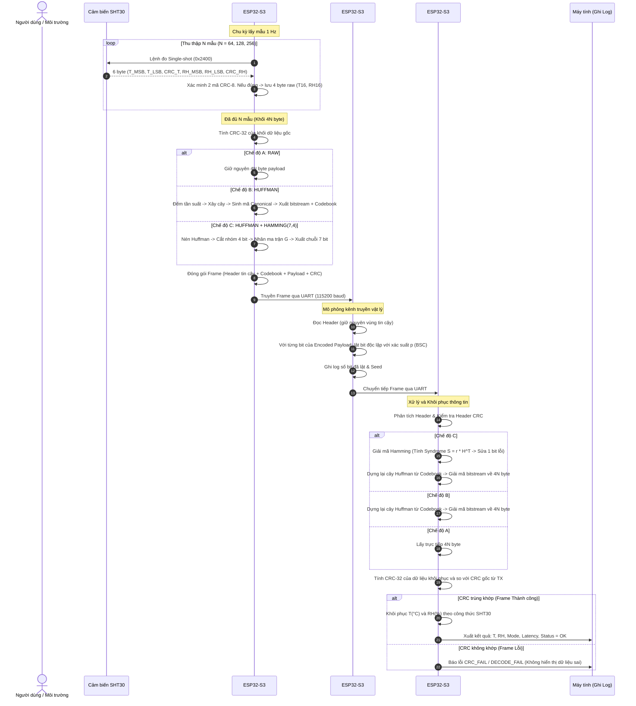
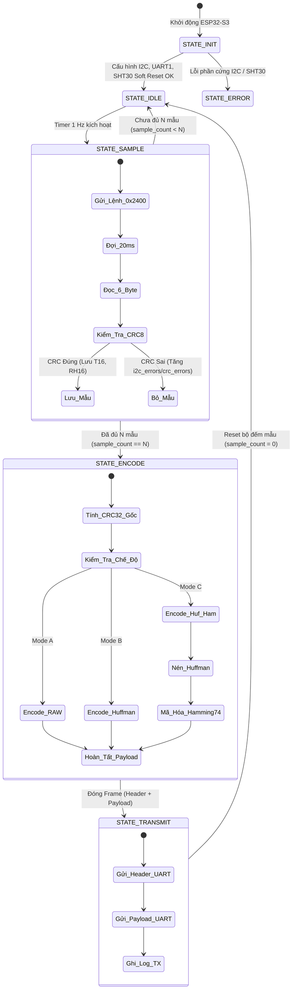

# SƠ ĐỒ KHỐI CẤU TRÚC VÀ WORKFLOW HỆ THỐNG TRUYỀN THÔNG TIN (SHT30 - 3 ESP32-S3)

> **Tài liệu:** Sơ đồ khối, Cấu trúc thư mục và Luồng thực thi (Workflow)  
> **Căn cứ yêu cầu:** [README.md](file:///C:/Users/ADMIN/Documents/Decoder_and_Encoder/README.md)  
> **Quy mô:** 3 module phần cứng độc lập (TX $\rightarrow$ CHANNEL $\rightarrow$ RX)  

---

## 1. Sơ đồ Khối Tổng thể Toàn Hệ thống (System Architecture)

Hệ thống được thiết kế theo mô hình phân tầng truyền thông kinh điển của Shannon, triển khai thực tế trên 3 vi điều khiển ESP32-S3:

```mermaid
flowchart LR
    subgraph NODE1["ESP32-S3 #1: MÁY PHÁT (TX)"]
        direction TB
        SHT["Cảm biến SHT30"] -- "I2C (SDA:8, SCL:9)" --> DRV["SHT30 Driver<br/>(CRC-8 Check)"]
        DRV --> BUF["Bộ đệm N mẫu<br/>(Raw 4N byte)"]
        BUF --> SW{"Lựa chọn Chế độ<br/>(Mode Selector)"}
        
        SW -- "Mode A: RAW" --> PKT["Đóng gói Frame"]
        SW -- "Mode B: HUFFMAN" --> HUF["Huffman Encoder<br/>(Mã hóa nguồn)"]
        SW -- "Mode C: HUF + HAM" --> HUF2["Huffman Encoder<br/>(Mã hóa nguồn)"]
        
        HUF --> PKT
        HUF2 --> HAM["Hamming(7,4) Encoder<br/>(Mã hóa kênh hệ thống)"]
        HAM --> PKT
        
        PKT --> UART1_TX["UART1 TX<br/>(115200, 8N1)"]
    end

    subgraph NODE2["ESP32-S3 #2: KÊNH TRUYỀN (CHANNEL)"]
        direction TB
        UART2_RX["UART RX"] --> PARSE_CH["Tách Frame<br/>(Header / Payload)"]
        PARSE_CH --> BSC["Mô hình Kênh BSC(p)<br/>(Lật bit độc lập với xác suất p)"]
        BSC --> STAT_CH["Ghi nhận Thống kê<br/>(Số bit lật, Seed, BER kênh)"]
        STAT_CH --> UART2_TX["UART TX<br/>(Chuyển tiếp Frame)"]
    end

    subgraph NODE3["ESP32-S3 #3: MÁY THU (RX)"]
        direction TB
        UART3_RX["UART RX"] --> PARSE_RX["Phân tích Frame<br/>(Check Header CRC)"]
        PARSE_RX --> MODE_DEC{"Kiểm tra Chế độ"}
        
        MODE_DEC -- "Mode C" --> HAM_DEC["Hamming(7,4) Decoder<br/>(Sửa lỗi đơn bằng Syndrome)"]
        HAM_DEC --> HUF_DEC["Huffman Decoder<br/>(Khôi phục dữ liệu gốc)"]
        
        MODE_DEC -- "Mode B" --> HUF_DEC
        MODE_DEC -- "Mode A" --> RAW_OUT["Trích xuất Raw 4N byte"]
        
        HUF_DEC --> VERIFY["Kiểm tra CRC-32 Gốc<br/>(Phân loại: OK / FAIL)"]
        RAW_OUT --> VERIFY
        
        VERIFY --> METRICS["Tính toán Chỉ số<br/>(BER đầu cuối, Latency, Throughput)"]
        METRICS --> CONV["Quy đổi T(°C) & RH(%)<br/>(Hiển thị / Xuất CSV)"]
    end

    UART1_TX ==>|"Dây UART (TX -> RX)"| UART2_RX
    UART2_TX ==>|"Dây UART (TX -> RX)"| UART3_RX
```



---

## 2. Cấu trúc Thư mục Toàn diện Dự án (Project Directory Tree)

Cấu trúc thư mục được tổ chức chuẩn hóa theo hướng dẫn phát triển của Zephyr RTOS và bài tập lớn:

```text
Decoder_and_Encoder/
├── README.md                      # Đặc tả kỹ thuật và phân công nhiệm vụ
├── Tutorial.md                    # Hướng dẫn build, flash và debug Zephyr
├── tree.md                        # Sơ đồ khối, cấu trúc và workflow (file này)
├── Haming74_Description.md        # Thuyết minh chi tiết thuật toán Hamming(7,4)
├── Huffman_Description.md         # Thuyết minh chi tiết thuật toán Huffman
│
├── .vscode/                       # Cấu hình môi trường VS Code
│   ├── c_cpp_properties.json      # IntelliSense và đường dẫn include
│   ├── settings.json              # Thiết lập IDE
│   └── tasks.json                 # Phím tắt tác vụ build/flash
│
├── build/                         # Thư mục chứa file nhị phân sau biên dịch
│   └── encoder/                   # Kết quả build của máy phát (TX)
│
├── firmware/                      # Mã nguồn firmware trên 3 ESP32-S3
│   │
│   ├── encoder/                   # [MODULE 1] MÁY PHÁT (TX)
│   │   ├── app.overlay            # Devicetree gán I2C0 (GPIO8/9), SHT30 (0x44), UART1
│   │   ├── CMakeLists.txt         # Kịch bản build CMake cho TX
│   │   ├── prj.conf               # Cấu hình Kconfig Zephyr (I2C, UART, Console)
│   │   ├── src/
│   │   │   └── main.c             # State Machine chính của TX: Đọc, Gom mẫu, Encode, Gửi
│   │   ├── include/
│   │   │   ├── sht30_driver/      # Driver đọc SHT30, tính CRC-8, gom raw 16-bit
│   │   │   │   ├── sht30_driver.h
│   │   │   │   └── sht30_driver.c
│   │   │   ├── huffman_encoder/   # Mã hóa nguồn Huffman Canonical & tính Entropy
│   │   │   │   ├── huffman_encoder.h
│   │   │   │   └── huffman_encoder.c
│   │   │   ├── hamming74_encoder/ # Mã hóa kênh Hamming(7,4) dạng hệ thống
│   │   │   │   ├── hamming74_encoder.h
│   │   │   │   └── hamming74_encoder.c
│   │   │   └── frame_protocol.h   # Định nghĩa cấu trúc khung truyền (Header, CRC)
│   │   └── sourcepy/
│   │       └── collect_logs.py    # Script đọc log Serial từ cổng COM
│   │
│   ├── channel_bsc/               # [MODULE 2] KÊNH TRUYỀN (CHANNEL)
│   │   ├── CMakeLists.txt
│   │   ├── prj.conf
│   │   └── src/
│   │       ├── main.c             # Nhận UART TX -> Lật bit payload -> Chuyển tiếp RX
│   │       └── bsc_simulator.c    # Thuật toán giả lập nhiễu bit BSC(p) theo seed
│   │
│   └── decoder/                   # [MODULE 3] MÁY THU (RX)
│       ├── CMakeLists.txt
│       ├── prj.conf
│       └── src/
│           ├── main.c             # State Machine chính của RX: Nhận, Parse, Decode, Log
│           ├── hamming74_decoder.c# Giải mã Syndrome, sửa 1 bit lỗi
│           ├── huffman_decoder.c  # Dựng cây từ Codebook, giải nén dữ liệu thô
│           └── metrics_calc.c     # Tính BER đầu cuối, Packet Success Rate, Hiển thị T/RH
│
├── data/                          # Dữ liệu thử nghiệm và Golden Dataset
│   ├── sht30_golden_dataset.csv   # Tập mẫu chuẩn đo thật (dùng để so sánh BER 100%)
│   └── synthetic_test_vectors.bin # Mẫu thử nghiệm biên
│
└── docs/                          # Tài liệu báo cáo môn học
    ├── protocol_specification.md  # Chi tiết định dạng Byte/Bit trên đường truyền
    └── test_results/              # Bảng số liệu, đồ thị BER, Compression Ratio
```

---

## 3. Workflow Toàn Hệ thống (End-to-End Sequence Diagram)

Trình tự luồng dữ liệu truyền qua 3 bo mạch vi điều khiển:



---

## 4. Chi tiết Workflow Khối Máy Phát (TX - Encoder State Machine)

Máy phát hoạt động dưới dạng một máy trạng thái hữu hạn (**FSM - Finite State Machine**):



---

## 5. Chi tiết Định dạng Gói tin Truyền qua UART (Frame Format)

Để bảo đảm máy thu (RX) không bị mất đồng bộ do nhiễu lật bit làm hỏng Header, gói tin được cấu trúc thành **2 vùng rõ ràng**:

| Thứ tự | Trường dữ liệu | Kích thước | Mô tả |
| :---: | :--- | :---: | :--- |
| **VÙNG 1: HEADER TIN CẬY (Không bị kênh chèn nhiễu trong thí nghiệm chính)** | | | |
| 1 | `MAGIC_BYTE` | 2 byte | Cố định `0xAA 0x55` để nhận diện điểm bắt đầu Frame |
| 2 | `VERSION` | 1 byte | Phiên bản giao thức (ví dụ: `0x01`) |
| 3 | `MODE` | 1 byte | `0x01` (Mode A: RAW), `0x02` (Mode B: HUF), `0x03` (Mode C: HUF+HAM) |
| 4 | `SEQUENCE_ID` | 2 byte | Số thứ tự gói tin (0, 1, 2, ...) dùng đối chiếu golden dataset |
| 5 | `SAMPLE_COUNT` | 2 byte | Số mẫu trong gói (thường là $N = 64, 128, 256$) |
| 6 | `ORIGINAL_CRC32` | 4 byte | Mã CRC-32 của $4N$ byte dữ liệu thô ban đầu |
| 7 | `HUFFMAN_VALID_BITS`| 2 byte | Số bit nén hợp lệ (để RX bỏ qua các bit padding ở byte cuối) |
| 8 | `CODED_PAYLOAD_LEN` | 2 byte | Độ dài thực tế (số byte) của vùng Payload phía sau |
| 9 | `HEADER_CRC16` | 2 byte | Mã CRC-16 bảo vệ riêng vùng Header này |
| **VÙNG 2: CODEBOOK METADATA (Chỉ xuất hiện ở Mode B và Mode C)** | | | |
| 10 | `USED_SYMBOLS_COUNT`| 2 byte | Số lượng ký hiệu phân biệt ($M \le 256$) |
| 11 | `ENTRIES_TABLE` | $2M$ byte | Danh sách các cặp `[Symbol (1B), Code_Length (1B)]` |
| **VÙNG 3: ENCODED PAYLOAD (Vùng chịu tác động của mô hình nhiễu BSC(p))** | | | |
| 12 | `PAYLOAD_DATA` | Biến thiên | Dữ liệu đo (Raw 4N byte, hoặc Bitstream Huffman, hoặc Bitstream Hamming) |

---

## 6. Ma trận So sánh 3 Chế độ và Tiêu chí Đánh giá (Metrics Matrix)

Bảng đối chiếu phục vụ thực nghiệm và đánh giá chất lượng hệ thống:

| Tiêu chí | Chế độ A: RAW | Chế độ B: HUFFMAN | Chế độ C: HUF + HAMMING |
| :--- | :---: | :---: | :---: |
| **Mã hóa nguồn** | Không | Huffman Canonical | Huffman Canonical |
| **Mã hóa kênh** | Không | Không | Hamming(7,4) hệ thống |
| **Dung lượng Payload** | $4N$ byte (cố định) | Giảm theo phân bố entropy | Tăng $\approx 75\%$ so với Mode B |
| **Độ nhạy với nhiễu ($p > 0$)** | Lỗi phân tán theo từng byte | Cực kỳ nhạy cảm (1 bit lật làm hỏng toàn bộ frame) | Sửa được toàn bộ lỗi đơn 1 bit/codeword |
| **Trường hợp lý tưởng ($p = 0$)** | Khôi phục đúng $100\%$ | Khôi phục đúng $100\%$ | Khôi phục đúng $100\%$ |
| **Mục đích khoa học** | Đo đường cơ sở (Baseline) | Đo hiệu quả nén nguồn & Entropy | Chứng minh khả năng sửa lỗi kênh |
| **Các chỉ số chính đo đạc** | Throughput, BER kênh | $H(X)$, $\bar{L}$, Net Ratio | BER đầu cuối, Frame Success Rate |
