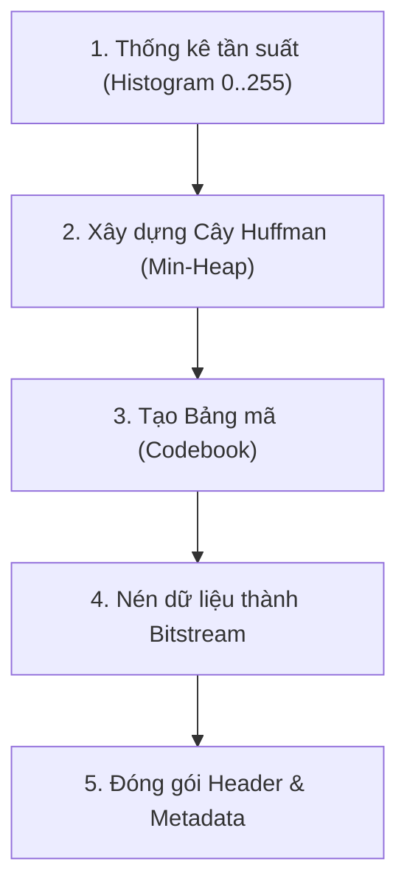

# THUẬT TOÁN MÃ HÓA NGUỒN HUFFMAN (HUFFMAN SOURCE CODING)

> **Môn học:** Lý thuyết thông tin  
> **Dự án:** Hệ thống truyền thông tin qua 3 ESP32-S3 sử dụng cảm biến SHT30  
> **Khối phụ trách:** Máy phát (TX - Encoder) & Máy thu (RX - Decoder)  
> **Tài liệu tham chiếu:** [README.md](file:///C:/Users/ADMIN/Documents/Decoder_and_Encoder/README.md)

---

## 1. Mục tiêu và Vai trò trong Hệ thống

### 1.1. Khái niệm Mã hóa nguồn (Source Coding)
Mã hóa nguồn là quá trình biểu diễn thông tin từ nguồn phát bằng một chuỗi ký hiệu nhị phân (bit) sao cho **số bit trung bình dùng để biểu diễn một tin là nhỏ nhất**, bằng cách loại bỏ tính dư thừa thống kê (statistical redundancy) của dữ liệu.

### 1.2. Vị trí trong chuỗi truyền tin
```text
[Buffer SHT30] ---> [Huffman Encoder] ---> [Hamming(7,4) Encoder] ---> [UART TX] ---> (Kênh BSC)
(4N byte thô)        (Bitstream nén)       (Bảo vệ chống nhiễu)
```

- **Đầu vào của Huffman Encoder:** Bộ đệm chứa $N$ mẫu đo liên tiếp từ SHT30, mỗi mẫu gồm 4 byte thô (`T_MSB, T_LSB, RH_MSB, RH_LSB`). Tổng cộng $4N$ byte:
  - $N = 64$ mẫu $\rightarrow 256$ byte ($2.048$ bit).
  - $N = 128$ mẫu $\rightarrow 512$ byte ($4.096$ bit).
  - $N = 256$ mẫu $\rightarrow 1.024$ byte ($8.192$ bit).
- **Đầu ra:** Luồng bit nén có độ dài biến thiên (Variable-length bitstream) kèm theo **Metadata/Codebook** để máy thu (RX) có thể giải mã ngược lại chính xác $100\%$ (Lossless Compression).

---

## 2. Cơ sở Lý thuyết Thông tin

### 2.1. Phân bố xác suất và Lượng tin
Xét nguồn rời rạc gồm $M \le 256$ ký hiệu byte khác nhau $S = \{s_1, s_2, \dots, s_M\}$.  
Xác suất xuất hiện của ký hiệu $s_i$ trong khối dữ liệu độ dài $K = 4N$ byte là:
$$P(s_i) = \frac{f(s_i)}{K}$$
*(với $f(s_i)$ là số lần xuất hiện của byte $s_i$).*

Lượng tin riêng của ký hiệu $s_i$:
$$I(s_i) = -\log_2 P(s_i) \quad (\text{bit})$$

### 2.2. Entropy của Nguồn tin $H(X)$
Entropy biểu thị lượng tin trung bình chứa trong một byte của dữ liệu SHT30:
$$H(X) = -\sum_{i=1}^{M} P(s_i) \log_2 P(s_i) \quad (\text{bit/byte})$$

### 2.3. Định lý Mã hóa nguồn Shannon
Độ dài từ mã trung bình $\bar{L}$ của mã Huffman tối ưu thỏa mãn:
$$H(X) \le \bar{L} < H(X) + 1 \quad (\text{bit/byte})$$
Trong đó:
$$\bar{L} = \sum_{i=1}^{M} P(s_i) \cdot l_i$$
*($l_i$ là độ dài từ mã nhị phân gán cho byte $s_i$).*

- Ký hiệu xuất hiện **nhiều lần** (xác suất cao) $\rightarrow$ gán từ mã **ngắn** ($l_i$ nhỏ).
- Ký hiệu xuất hiện **ít lần** (xác suất thấp) $\rightarrow$ gán từ mã **dài** ($l_i$ lớn).

---

## 3. Quy trình Thuật toán Huffman tại Máy phát (TX)

Thuật toán gồm 4 giai đoạn rõ ràng:



### Bước 1: Thống kê tần số xuất hiện (Histogram)
- Khởi tạo mảng đếm tần suất `uint32_t freq[256] = {0};`.
- Duyệt qua toàn bộ $4N$ byte của khối dữ liệu và tăng bộ đếm tương ứng: `freq[data[i]]++`.
- Đếm tổng số ký hiệu phân biệt thực tế có mặt: `used_symbols` ($M \le 256$).

### Bước 2: Xây dựng Cây nhị phân Huffman (Huffman Tree)
1. Tạo một nút lá cho mỗi ký hiệu có tần suất $f(s_i) > 0$.
2. Đưa tất cả các nút lá vào một **hàng đợi ưu tiên nhỏ nhất (Min-Heap)** với độ ưu tiên là trọng số tần suất.
3. Lặp lại bước sau cho đến khi trong hàng đợi chỉ còn đúng **1 nút** (nút gốc - Root):
   - Lấy ra 2 nút có tần suất nhỏ nhất: $N_1$ và $N_2$.
   - Tạo một nút cha mới $N_{\text{parent}}$ với tần suất bằng tổng: $f(N_{\text{parent}}) = f(N_1) + f(N_2)$.
   - Gán con trái là $N_1$, con phải là $N_2$.
   - Đưa $N_{\text{parent}}$ trở lại hàng đợi.

### Bước 3: Trích xuất Bảng mã (Codebook Generation)
- Duyệt cây từ nút gốc xuống các nút lá bằng thuật toán DFS (Depth-First Search):
  - Rẽ sang nhánh **trái** $\rightarrow$ thêm bit `0`.
  - Rẽ sang nhánh **phải** $\rightarrow$ thêm bit `1`.
- Khi chạm nút lá (chứa byte $s_i$), lưu lại chuỗi bit và độ dài $l_i$ vào bảng mã `codebook[s_i]`.
- **Đặc tính tiền tố (Prefix-free):** Không có từ mã nào là tiền tố của từ mã khác. Điều này bảo đảm máy thu (RX) có thể giải mã tức thì từng ký hiệu mà không bị nhầm lẫn.

### Bước 4: Mã hóa dòng bit (Bitstream Packing)
- Duyệt lại mảng $4N$ byte đầu vào.
- Với mỗi byte, tra bảng `codebook` lấy chuỗi bit tương ứng và ghi nối tiếp vào mảng byte đầu ra `output_bits[]`.
- Lưu lại tổng số bit hợp lệ: `valid_bits`.
- Nếu `valid_bits` không chia hết cho 8, byte cuối cùng được chèn thêm các bit `0` (padding bits) cho tròn byte.

---

## 4. Hợp đồng Chia sẻ Codebook giữa Máy phát (TX) và Máy thu (RX)

Máy thu **bắt buộc phải biết cấu trúc cây hoặc bảng mã** thì mới giải mã được. Để tối ưu băng thông UART, ta chọn một trong hai phương án:

### Phương án khuyến nghị: Canonical Huffman Codebook
Thay vì gửi toàn bộ cây, TX chỉ gửi danh sách các ký hiệu có mặt và **độ dài từ mã** của chúng:
- Header gồm: `used_symbols_count` (1 byte).
- Tiếp theo là danh sách các cặp: `(symbol, code_length)` với mỗi ký hiệu xuất hiện.
Phía RX chỉ cần đọc danh sách độ dài này là có thể tái tạo lại bảng mã Canonical giống hệt TX trong $O(M)$ bước.

---

## 5. Cấu trúc Dữ liệu Đề xuất cho Module `huffman_encoder`

### 5.1. File Header: `huffman_encoder.h`
```c
#ifndef _HUFFMAN_ENCODER_H_
#define _HUFFMAN_ENCODER_H_

#include <stdint.h>
#include <stddef.h>

#define HUFFMAN_MAX_SYMBOLS 256

/* Cấu trúc lưu 1 từ mã của một ký hiệu */
typedef struct {
    uint32_t code;   /* Chuỗi bit mã hóa (lưu tối đa 32 bit) */
    uint8_t  len;    /* Số bit thực tế của từ mã */
} huffman_code_t;

/* Cấu trúc lưu Codebook gửi kèm sang RX */
typedef struct {
    uint16_t used_symbols_count;
    uint8_t  symbols[HUFFMAN_MAX_SYMBOLS];
    uint8_t  code_lengths[HUFFMAN_MAX_SYMBOLS];
} huffman_codebook_t;

/* Kết quả sau khi nén */
typedef struct {
    size_t   raw_bytes_count;     /* Số byte gốc trước khi nén (4N) */
    size_t   coded_valid_bits;    /* Số bit nén hợp lệ (chưa tính padding) */
    size_t   coded_bytes_count;   /* Số byte sau khi đóng gói bitstream */
    float    entropy;             /* Giá trị Entropy H(X) tính được */
    float    avg_code_len;        /* Độ dài mã trung bình L_bar */
    float    compression_ratio;   /* Tỷ lệ nén payload: raw_bits / coded_valid_bits */
} huffman_metrics_t;

/**
 * @brief Thực hiện mã hóa Huffman toàn bộ khối dữ liệu
 * @param in_data      Mảng dữ liệu thô (4N byte)
 * @param in_len       Độ dài mảng thô (4N)
 * @param out_bitstream Bộ đệm chứa bitstream nén
 * @param out_book     Con trỏ lưu codebook phục vụ gửi sang RX
 * @param metrics      Con trỏ nhận các chỉ số lý thuyết thông tin
 * @return 0 nếu thành công, số âm nếu lỗi
 */
int huffman_encode(const uint8_t *in_data, size_t in_len,
                   uint8_t *out_bitstream,
                   huffman_codebook_t *out_book,
                   huffman_metrics_t *metrics);

#endif
```

---

## 6. Phân tích Hiện tượng Thực nghiệm (Rất quan trọng cho Báo cáo)

### 6.1. Hiện tượng "Nén âm" (Negative Compression) trên Bản tin ngắn
- Khi $N = 64$ ($256$ byte) hoặc dữ liệu nhiệt độ/độ ẩm thay đổi liên tục khiến các byte phân bố đều, bảng mã (Codebook Header) có thể chiếm từ $30 - 80$ byte.
- Tổng dung lượng gói tin:
  $$\text{Dung lượng toàn gói} = \text{Header} + \text{Codebook} + \text{Bitstream nén} + \text{CRC}$$
  có thể **lớn hơn cả 256 byte gốc**.
- **Ý nghĩa học thuật:** Đây là minh chứng thực tế rõ nét nhất để sinh viên phân biệt giữa **Tỷ lệ nén thuần trên payload** và **Tỷ lệ nén thực tế toàn gói (Net Compression Ratio)**. Không phải lúc nào nén cũng làm giảm dung lượng truyền!

### 6.2. Tính nhạy cảm của Huffman với Nhiễu Kênh (Lý do cần Hamming phía sau)
- Mã Huffman là mã có độ dài biến thiên (Variable-length). Nếu một bit trên đường truyền bị kênh làm lật ($0 \rightarrow 1$ hoặc $1 \rightarrow 0$), máy thu (RX) sẽ:
  1. Nhận diện sai ký hiệu hiện tại.
  2. Bị lệch ranh giới từ mã (mất đồng bộ pha bit).
  3. Tất cả các ký hiệu tiếp theo sau vị trí bit lỗi đều bị giải mã sai hàng loạt (Error Propagation).
- **Kết luận:** Đây là lý do kiến trúc hệ thống bắt buộc phải đặt bộ **Hamming(7,4) đứng ngay sau Huffman** để sửa lỗi trước khi dữ liệu đi vào bộ giải mã Huffman.
